<p align="center">
  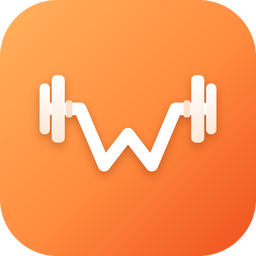
</p>

<h1 align="center">Wholeset</h1>

<p align="center">
  <b>Log every set from your wrist.</b><br>
  A workout tracker for Apple Watch and iPhone that saves to Apple Fitness.<br>
  Free, open source, no account, no limits on routines or history.
</p>

<p align="center">
  <a href="https://apps.apple.com/app/id6836587554"></a>
</p>

<p align="center">
  <a href="https://apps.apple.com/app/id6836587554"></a>
  
  
  <a href="https://github.com/0sahil/wholeset/actions/workflows/ci.yml"></a>
  <a href="LICENSE"></a>
</p>

<p align="center">
  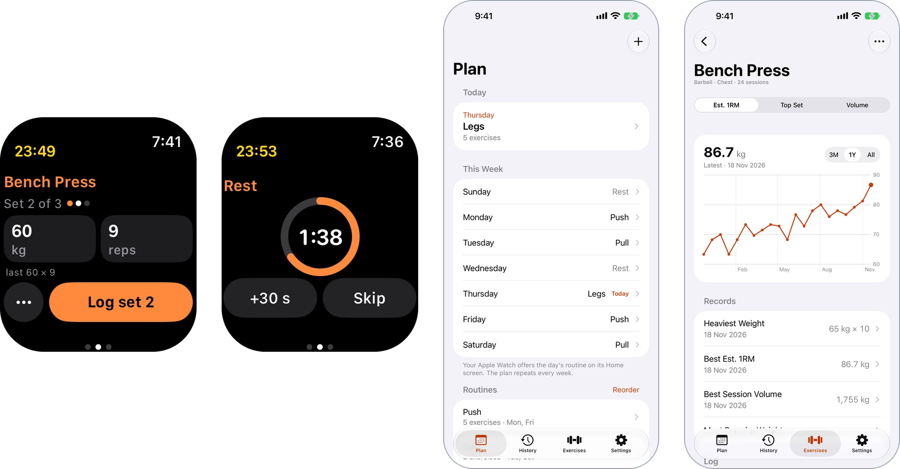
</p>

## Features

### Apple Watch: where you train

<p>
  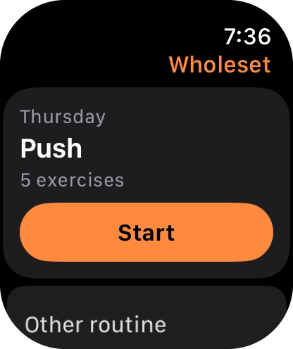
  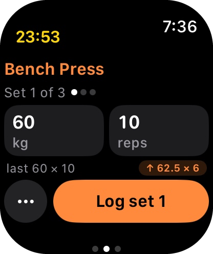
  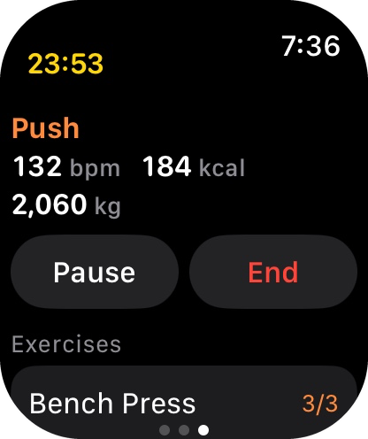
  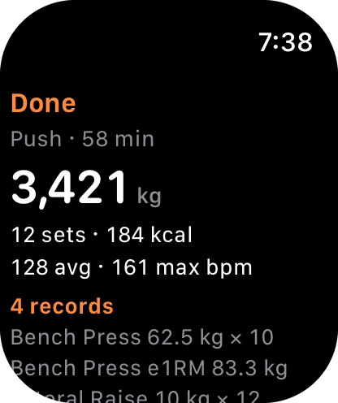
</p>

- Start today's routine from the Watch's home screen, or pick another one.
- Log each set with the Digital Crown. Weight and reps start from what you lifted last time.
- A hint suggests when to add weight (for example +2.5 kg on a barbell), and you choose how big the steps are.
- The rest timer starts by itself after each set and taps your wrist when it's over. Add 30 seconds or skip it.
- Live heart rate, calories and volume, plus the system Now Playing controls one swipe away.
- Swap an exercise, add or remove sets mid-workout. If the app quits mid-workout, it picks up where you left off.
- Works without your iPhone nearby. Each workout is saved to Apple Health, so it shows in Fitness and counts toward your Activity rings.

### iPhone: where you plan and review

<p>
  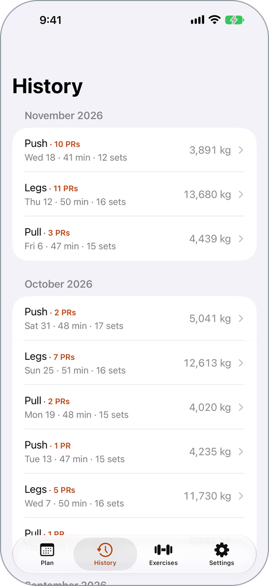
  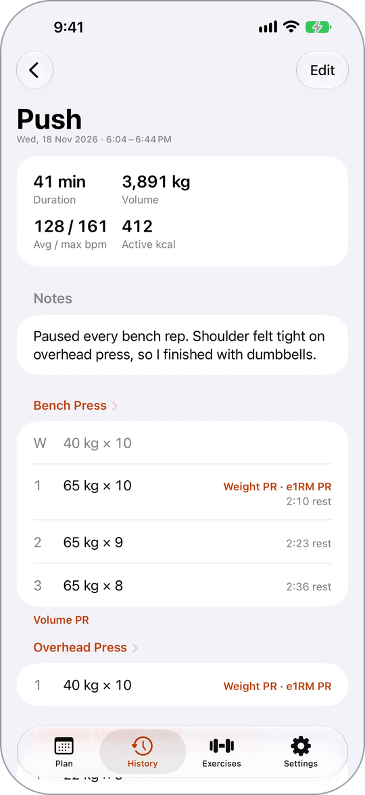
  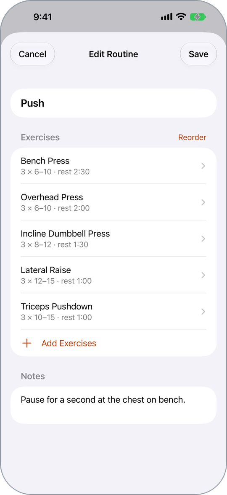
  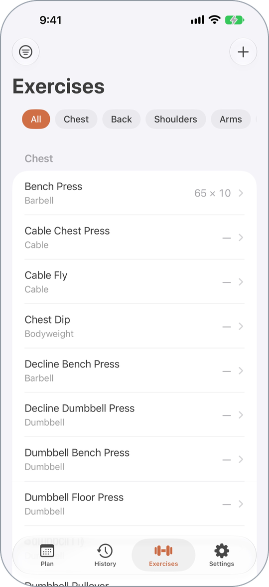
</p>

- A weekly plan: give each day a routine or a rest day, and it repeats every week.
- Routines with sets, rep ranges and rest times per exercise.
- An exercise library of 159 built-in exercises, plus any you add.
- Full history with search. Edit or delete past workouts.
- Records for every exercise: heaviest weight, best estimated 1RM, best session volume and most reps.
- Charts of estimated 1RM, top set and volume over time, and your best reps at each weight.
- Kilograms or pounds. Switch any time; your history is shown in the new unit.

### Bring your history from another app

<p>
  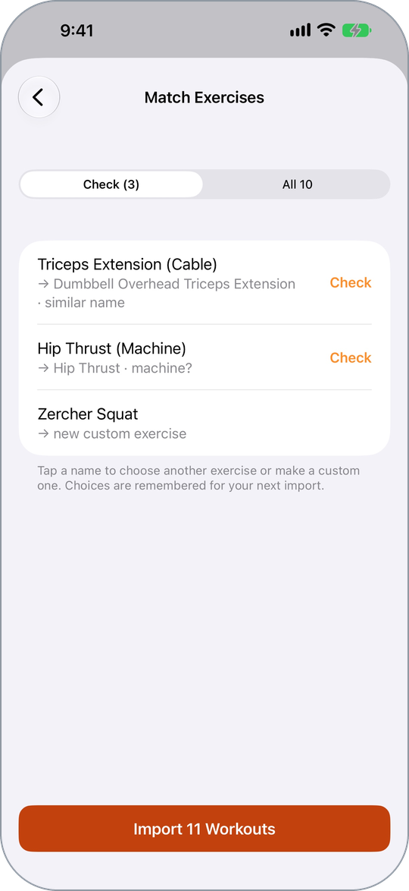
  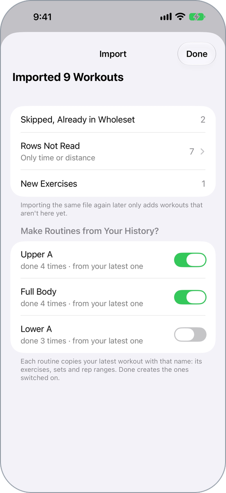
</p>

- Reads CSV exports from Strong, Hevy and FitNotes. Fitbod, StrongLifts 5×5 and Liftosaur are in beta.
- Any other CSV works too: you say which column holds what.
- Exercise names are matched to Wholeset's library, and you can review every match. Your choices are remembered for next time.
- Workouts you've already imported are skipped, so importing the same file twice is safe.
- Turns workouts you repeat often into routines, if you want.

## Privacy

- No account, no servers, no analytics, no ads, no third-party code.
- Your data stays on your devices and syncs through your own iCloud account (CloudKit private database). The developer can't see it.
- Workouts go to Apple Health only with your permission. Sets, reps and weights stay in Wholeset.
- Nothing reaches the developer unless you send a problem report from your own mail app.

Details are in the [privacy policy](PRIVACY.md).

## Why Wholeset

Most workout trackers are built for the phone, and their Watch apps are an afterthought: they mirror the phone, need it nearby, or leave out half the features. Others cap routines on the free tier or keep your history behind a subscription. Wholeset starts from the Watch: you run the whole workout from your wrist, it still lands in Apple Fitness, and your routines and history have no limits.

- **Watch first.** The whole workout runs on your wrist, with or without your iPhone.
- **No limits.** As many routines, exercises and workouts as you want, with your full history.
- **Your data stays yours.** It lives on your devices and in your own iCloud. There are no accounts or servers.
- **Native.** Built only with Apple's frameworks, so it looks and behaves like the rest of watchOS and iOS.
- **Open source.** Anyone can read the code, check the privacy claims, and build it themselves.

## Built with

Apple frameworks only: SwiftUI, SwiftData, CloudKit, HealthKit and Swift Charts. No third-party code.

## FAQ

**Do I need my iPhone with me at the gym?**
No. Once your routines have synced to the Watch, it runs the whole workout on its own. The workout syncs back to your iPhone through iCloud when the Watch can connect.

**Why isn't my workout in the Fitness app or counting toward my rings?**
Check that Wholeset may save workouts to Apple Health: in the Health app, open Sharing > Apps > Wholeset. Workouts imported from other apps are not written to Apple Health, since they're usually there already.

**How do I move over from Strong, Hevy or another app?**
Export a CSV from that app. Then in Wholeset, open Settings > Import from Another App and choose the file. You can also open the file in Wholeset from Files or the share sheet. The import screen shows how to export from each supported app.

**Kilograms or pounds?**
Either. Choose in Settings > Units. Weights are stored in kilograms, so switching never loses precision.

**Do I need an account?**
No. Sync uses the iCloud account already on your devices. If iCloud is off, Wholeset still works but doesn't sync between your iPhone and Watch.

**How do I delete my data?**
See [Deleting your data](PRIVACY.md#deleting-your-data) in the privacy policy.

**Is there an iPad, Mac or Android version?**
No. Wholeset is built for iPhone and Apple Watch only.

## Build from source

You need a Mac with Xcode 27 or later. The apps run on iOS 26 or later and watchOS 26 or later.

```sh
git clone https://github.com/0sahil/wholeset.git
cd wholeset
cp Config/Local.xcconfig.example Config/Local.xcconfig
```

In `Config/Local.xcconfig`, set `DEVELOPMENT_TEAM` to your team ID (Xcode > Settings > Accounts) and `BUNDLE_ID_PREFIX` to a reverse-DNS prefix you own, such as `com.yourname.wholeset`. With a free Apple ID, also set `WHOLESET_ICLOUD = NO`. Then open `Wholeset.xcodeproj` and run the `Wholeset` scheme (iPhone, with the Watch app inside) or the `WholesetWatch` scheme.

[docs/DEVELOPMENT.md](docs/DEVELOPMENT.md) covers running on your own devices, building with a free Apple ID, command-line builds, the demo screens and the tests.

## Project layout

| Path | Contents |
|---|---|
| `Wholeset/` | iOS app target |
| `WholesetWatch/` | watchOS app target (embedded in the iOS app, also runs on its own) |
| `WholesetKit/` | Swift package with the shared code: versioned SwiftData models and migrations, store setup, sync maintenance and status, the exercise library, the planning and workout logic, and the CSV import (readers, exercise matching, writing) |
| `Config/` | Build settings as `.xcconfig` files |
| `Scripts/` | `curate-exercise-library.py` builds the bundled exercise library; `make-app-icon.swift` draws the app icons; `archive.sh` and `ExportOptions.plist` archive and export a release build |
| `docs/` | [Development](docs/DEVELOPMENT.md) and [release](docs/RELEASING.md) notes, README images |

The shared logic is tested with Swift Testing and the tests run on macOS: `cd WholesetKit && swift test`.

## Contributing

Bug reports and ideas are welcome. Please read [CONTRIBUTING.md](CONTRIBUTING.md) before opening a pull request, and open an issue or discussion first for anything beyond a small fix. Everyone taking part follows the [code of conduct](CODE_OF_CONDUCT.md).

## Translations

Wholeset is English only for now. If you'd like to translate it, open an issue first (see [Translations](CONTRIBUTING.md#translations)).

## Reporting a problem

- In the iPhone app, open Settings > Report a Problem. It starts an email with the app version and device model filled in. Nothing is sent until you send it.
- Or email 0sahil.dev@gmail.com.
- Or [open an issue](https://github.com/0sahil/wholeset/issues/new/choose). Questions and ideas go to [Discussions](https://github.com/0sahil/wholeset/discussions).
- Security problems: see [SECURITY.md](SECURITY.md).

Changes in each release are listed in the [changelog](CHANGELOG.md).

## Disclaimer

Wholeset is a workout log, not a medical device, and doesn't give medical advice. Estimated 1RM and progression hints are estimates. Wholeset is an independent project, not affiliated with or endorsed by Apple. Apple Watch, iPhone, Apple Health and Apple Fitness are trademarks of Apple Inc.

## License

[GPL-3.0-or-later](LICENSE).

The built-in exercise library is curated from [free-exercise-db](https://github.com/yuhonas/free-exercise-db), which is in the public domain (Unlicense).
